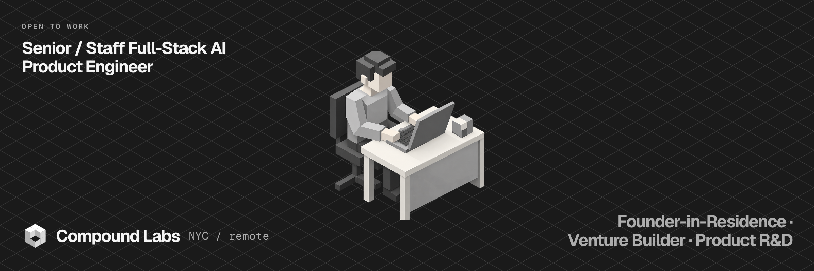
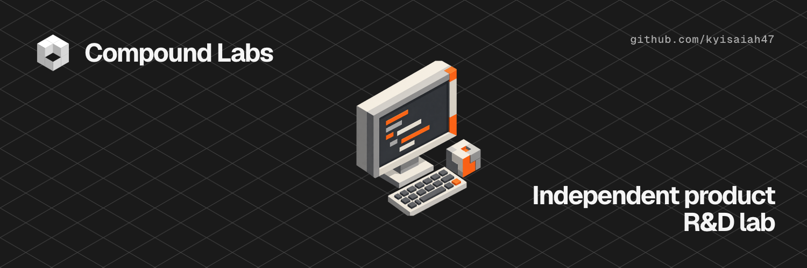
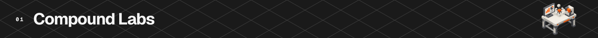
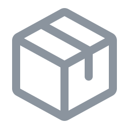
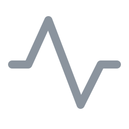
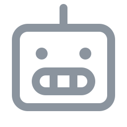
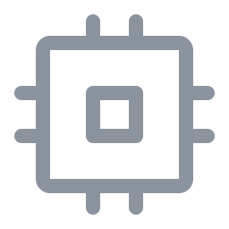
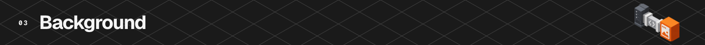

**Full-time · NYC or remote · US citizen · no sponsorship required. [Send me the role →](mailto:kyisaiah47@gmail.com)**

### Founder &amp; product builder at Compound Labs. Senior full-stack engineer focused on 0→1 AI products.

**[thecompound.tech](https://thecompound.tech)** · **[LinkedIn](https://linkedin.com/in/kyisaiah47)** · **[Email](mailto:kyisaiah47@gmail.com)**

I have 8+ years as a full-stack engineer, including 3+ at senior level. I do my best work on ambiguous 0→1 builds where I can own the path from research and product strategy through UX, engineering, launch, and operation.

### Compound Labs

**[Compound Labs](https://thecompound.tech)** is my independent product R&amp;D lab. I research opportunities and underserved problems, turn the strongest ones into working software, launch them, and operate the systems behind them.

Compound Labs now brings developer tools and news sections together under one site, alongside the standalone products I continue to build and operate. The [Compound Labs site](https://thecompound.tech) is the current home for that work.

- **Complete product ownership** — strategy, UX, engineering, authentication, billing, data, automation, analytics, launch, and ongoing operations.
- **Applied AI as an engineering system** — structured outputs, model routing, per-call cost and latency telemetry, tenant-scoped memory, reproducible benchmarks, and quality gates.
- **Shared operating infrastructure** — reusable multi-tenant foundations, payments, scheduled workflows, browser automation, integrations, publishing, and one internal console for the catalog.
- **Distribution alongside product** — SEO, newsletters, automated content systems, social publishing, and product-level analytics.

### Products and publications

<table>
<thead><tr><th>Product</th><th>What it does</th></tr></thead>
<tbody>
<tr><td nowrap="nowrap">&nbsp;&nbsp;<a href="https://opencal.link">OpenCal</a></td><td>Shares open meeting times from multiple calendars on one link, without exposing events.</td></tr>
<tr><td nowrap="nowrap">&nbsp;&nbsp;<a href="https://opensocials.thecompound.tech">OpenSocials</a></td><td>Drafts and schedules social posts for review before they go out.</td></tr>
<tr><td nowrap="nowrap">&nbsp;&nbsp;<a href="https://openjobs.thecompound.tech">OpenJobs</a></td><td>Finds job postings, helps complete employer forms, and waits for review before submission.</td></tr>
<tr><td nowrap="nowrap">&nbsp;&nbsp;<a href="https://blockdex.thecompound.tech">BlockDex</a></td><td>Searches individual components across public shadcn registries.</td></tr>
<tr><td nowrap="nowrap">&nbsp;&nbsp;<a href="https://breachprobe.thecompound.tech">BreachProbe</a></td><td>Scans a live app for exposed data and tests whether two users can read each other's rows.</td></tr>
<tr><td nowrap="nowrap">&nbsp;&nbsp;<a href="https://citerank.thecompound.tech">CiteRank</a></td><td>Tracks whether AI answer engines cite, name, or omit a product.</td></tr>
<tr><td nowrap="nowrap">&nbsp;&nbsp;<a href="https://skillworks.thecompound.tech">SkillWorks</a></td><td>Reads and scores Claude Code skills, agents, and plugins from their source.</td></tr>
<tr><td nowrap="nowrap">&nbsp;&nbsp;<a href="https://frontwire.thecompound.tech">Front&nbsp;Wire</a></td><td>Publishes breaking news linked to its sources.</td></tr>
<tr><td nowrap="nowrap">&nbsp;&nbsp;<a href="https://stillmornings.thecompound.tech">Still&nbsp;Mornings</a></td><td>A browsable publication of short video entries.</td></tr>
<tr><td nowrap="nowrap">&nbsp;&nbsp;<a href="https://whyyourbrain.thecompound.tech">Why&nbsp;Your&nbsp;Brain&nbsp;Does&nbsp;That</a></td><td>A searchable publication about psychological phenomena.</td></tr>
</tbody>
</table>

### Developer tools on Compound Labs

<table>
<thead><tr><th>Section</th><th>What it does</th></tr></thead>
<tbody>
<tr><td nowrap="nowrap">&nbsp;&nbsp;<a href="https://thecompound.tech/tools/infrastructure-cost-calculator">Infrastructure&nbsp;Cost&nbsp;Calculator</a></td><td>Compare the cost of running your stack.</td></tr>
<tr><td nowrap="nowrap">&nbsp;&nbsp;<a href="https://thecompound.tech/tools/starter-kit-comparison">Starter&nbsp;Kit&nbsp;Comparison</a></td><td>Compare starter kits before you build.</td></tr>
<tr><td nowrap="nowrap">&nbsp;&nbsp;<a href="https://thecompound.tech/tools/ai-coding-rules">AI&nbsp;Coding&nbsp;Rules</a></td><td>Find rules for your AI coding assistant.</td></tr>
<tr><td nowrap="nowrap">&nbsp;&nbsp;<a href="https://thecompound.tech/tools/tool-maintenance-tracker">Tool&nbsp;Maintenance&nbsp;Tracker</a></td><td>Check whether a developer tool is still maintained.</td></tr>
<tr><td nowrap="nowrap">&nbsp;&nbsp;<a href="https://thecompound.tech/tools/mobile-app-builder-comparison">Mobile&nbsp;App&nbsp;Builder&nbsp;Comparison</a></td><td>Compare builders for shipping mobile apps.</td></tr>
<tr><td nowrap="nowrap">&nbsp;&nbsp;<a href="https://thecompound.tech/tools/ai-coding-tool-tracker">AI&nbsp;Coding&nbsp;Tool&nbsp;Tracker</a></td><td>Track changes across AI coding tools.</td></tr>
</tbody>
</table>

### Developer news on Compound Labs

<table>
<thead><tr><th>Section</th><th>What it does</th></tr></thead>
<tbody>
<tr><td nowrap="nowrap">&nbsp;&nbsp;<a href="https://thecompound.tech/news/releases">Releases,&nbsp;Security&nbsp;&amp;&nbsp;Outages</a></td><td>Follow software releases, vulnerabilities and incidents.</td></tr>
<tr><td nowrap="nowrap">&nbsp;&nbsp;<a href="https://thecompound.tech/news/developer-tools">New&nbsp;Developer&nbsp;Tools</a></td><td>Discover new tools for developers.</td></tr>
<tr><td nowrap="nowrap">&nbsp;&nbsp;<a href="https://thecompound.tech/news/ai">AI&nbsp;Models,&nbsp;Pricing&nbsp;&amp;&nbsp;API&nbsp;Changes</a></td><td>Keep up with model releases and API changes.</td></tr>
</tbody>
</table>

### Engineering background

#### SS&amp;C Technologies — Senior Software Engineer, Private Markets

I was the division’s first web engineer, owning frontend architecture and cross-functional delivery across six enterprise applications.

- Architected and delivered the MVP of a 109+ component Angular DevOps platform in three months, retired the legacy application it replaced in five, and reduced per-client pipeline work from roughly 10 minutes to 30 seconds. It became the daily operating surface for 30+ engineers.
- Designed an AI-assisted code-generation system that compressed an estimated 12+ months of financial-reporting development into 2–3 months for a platform supporting 2,000+ clients and 17+ report types.
- Built a 36-component Angular library and custom CLI that reduced new frontend setup from days to minutes.
- Built a GoJS fund-visualization tool supporting 1,000+ node graphs across five layout algorithms.

### Earlier work

- **Capital Technology Group** — React and Java Spring Boot on a USCIS government contract serving millions of users, including WCAG accessibility work.
- **NoNameCharli** — led three junior engineers and shipped a live NFT mint across Next.js, Ethers.js, Hardhat, and Solidity.
- **Visneta** — led a complete Vue.js product redesign in direct collaboration with company leadership.
- **Drexel University** — B.S. Computer Science, *Cum Laude*.

<strong>Recognition and technical range</strong>

 

- 🥇 **1st Place — Starknet Re{Solve} Hackathon**, Bitcoin Unleashed Track (Xverse Prize Pool), Oct 2025 — [BTCUSD](https://github.com/kyisaiah47/btcusd-stablecoin), a Bitcoin-backed stablecoin with automatic Vesu yield routing.
- 🎖 **HackFS Finalist, ETHGlobal** — Split Protocol, a cross-token payment splitter on Uniswap.
- 📐 **OGC 2026 — LG CNS Optimization Grand Challenge** — Tier 3 of 19 (~top 15%), solo US entry against 200+ teams; the solver beat the baseline on 19 of 20 instances, by up to 349×.

**Core stack**

`TypeScript` · `Next.js 16` · `React 19` · `Tailwind v4` · `Node.js` · `Python` · `Java Spring Boot` · `Postgres` · `Supabase RLS` · `Stripe` · `MCP` · `Playwright` · `AWS` · `Vercel`

**Product and AI systems**

Applied AI and agents · structured outputs · model routing · evals · multi-tenant architecture · billing · data pipelines · browser automation · analytics · SEO · content and publishing systems

 

**Open to Senior / Staff Full-Stack AI Product Engineer roles.**

**[Email](mailto:kyisaiah47@gmail.com)** · **[LinkedIn](https://linkedin.com/in/kyisaiah47)** · **[Compound Labs](https://thecompound.tech)** · **[Buy me a coffee](https://buymeacoffee.com/kyisaiah47)**

New York City · remote · US citizen · no sponsorship required

