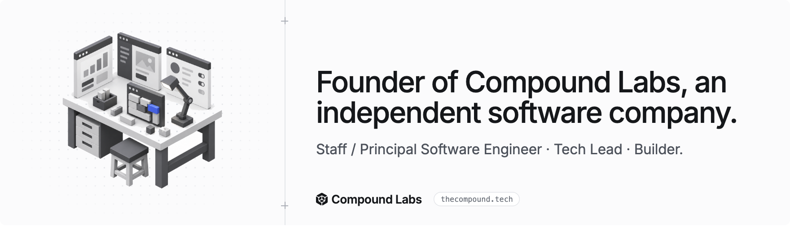
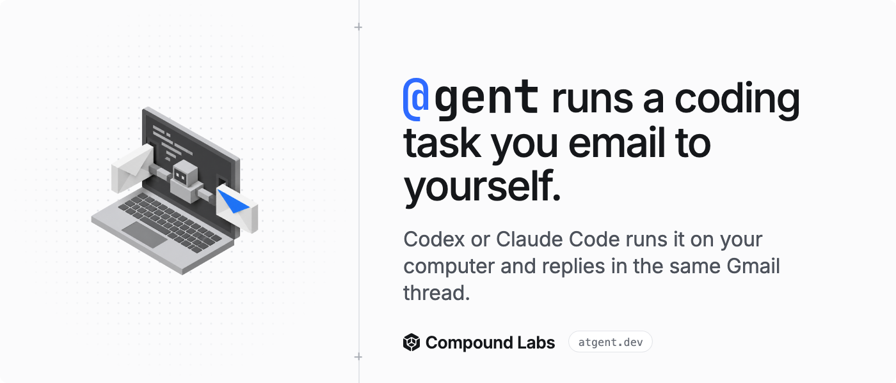
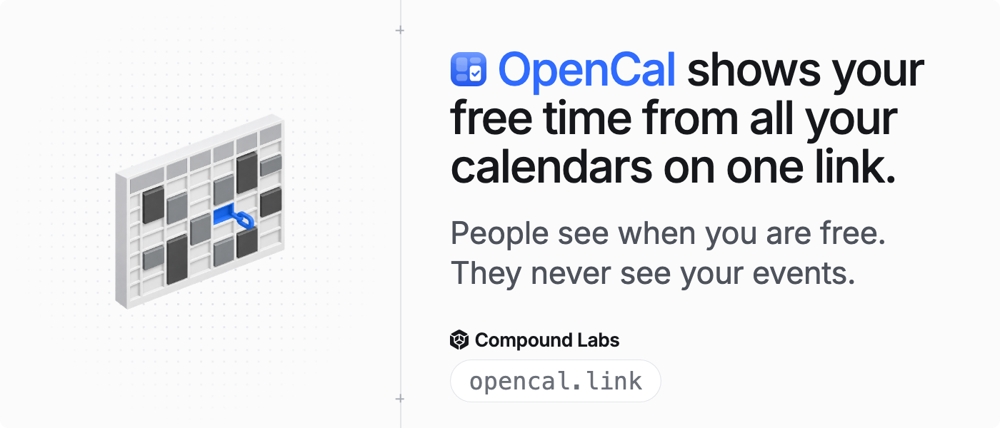
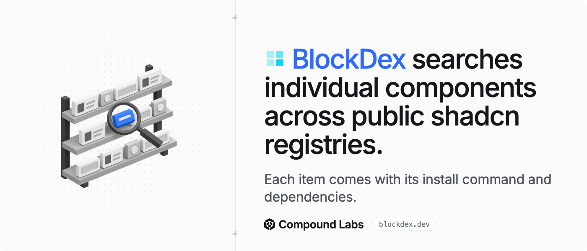
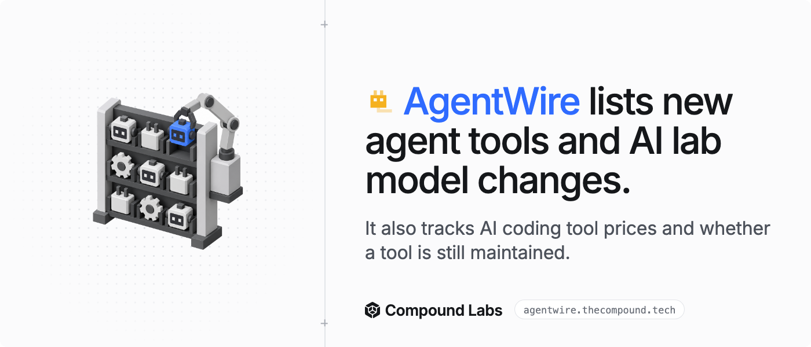

**[thecompound.tech](https://thecompound.tech)** · **[LinkedIn](https://linkedin.com/in/kyisaiah47)** · **[Email](mailto:kyisaiah47@gmail.com)**

**Open to: Staff / Principal Software Engineer · Tech Lead · Builder** · New York, NY · Remote

I build products end to end: research, product decisions, engineering, launch and operations. I run Compound Labs, my independent product R&D lab, where I ship and operate my own products with Claude Code and Codex agents.

### Compound Labs

[Compound Labs](https://thecompound.tech) is my independent product R&D lab. I research problems, build products for them, launch them and keep them running.

- **AI software factory.** Parallel Claude Code and Codex agents work across research, product, infrastructure and operations. Tests, hooks and quality gates check the work before it reaches production.
- **Operator platform.** One internal console tracks products, traffic, search, model costs and social posts. An MCP server answers questions about that data.
- **Distribution.** The lab posts across YouTube, X, LinkedIn and Instagram. Over 30 days it drove 130K+ social views and 6K+ website visitors.
- **Benchmarks.** ParseRail, the lab's document-extraction API, scored 99.4% on invoice fields against 92.2% for AWS Textract and 93.1% for Google Document AI, on a reproducible public benchmark.

### Products

More products are on [thecompound.tech](https://thecompound.tech).

### Before Compound Labs

**SS&amp;C Technologies** · Senior Software Engineer, Private Markets · 2023–2026

I was the first web engineer in the Private Markets division.

- Built an Azure DevOps platform that 30+ engineers use daily. Pipeline work per client went from about 10 minutes to 30 seconds.
- Cut reporting development from 12 months to 2–3 months with AI-assisted code generation, for a platform that serves 2,000+ clients.
- Set the division's web architecture standards with an Angular CLI scaffolder and a 36-component UI library.

**Earlier**

- **Capital Technology Group** · React and Spring Boot features for uscis.gov, which serves millions of users.
- **NoNameCharli** · Led three engineers and shipped a Next.js product with a live NFT mint.
- **Visneta** · Led a year-long redesign of the company's Vue.js web app.
- **Drexel University** · B.S. Computer Science, Cum Laude.

<strong>Awards and stack</strong>

 

- 🥇 **1st Place, Starknet Re{Solve} Hackathon 2025** · Bitcoin Unleashed track, Xverse Prize Pool · [BTCUSD](https://github.com/kyisaiah47/btcusd-stablecoin)
- 🎖 **HackFS Finalist, ETHGlobal 2022** · Split Protocol, cross-token payment splitting

`TypeScript` · `React` · `Next.js` · `Angular` · `Vue` · `Node.js` · `Python` · `Java Spring Boot` · `Postgres` · `Supabase` · `Stripe` · `Cloudflare` · `AWS` · `Playwright` · `Claude Code` · `Codex` · `MCP`

 

**Open to: Staff / Principal Software Engineer · Tech Lead · Builder**

**[Email](mailto:kyisaiah47@gmail.com)** · **[LinkedIn](https://linkedin.com/in/kyisaiah47)** · **[thecompound.tech](https://thecompound.tech)** · **[Buy me a coffee](https://buymeacoffee.com/kyisaiah47)**

New York, NY · Remote

